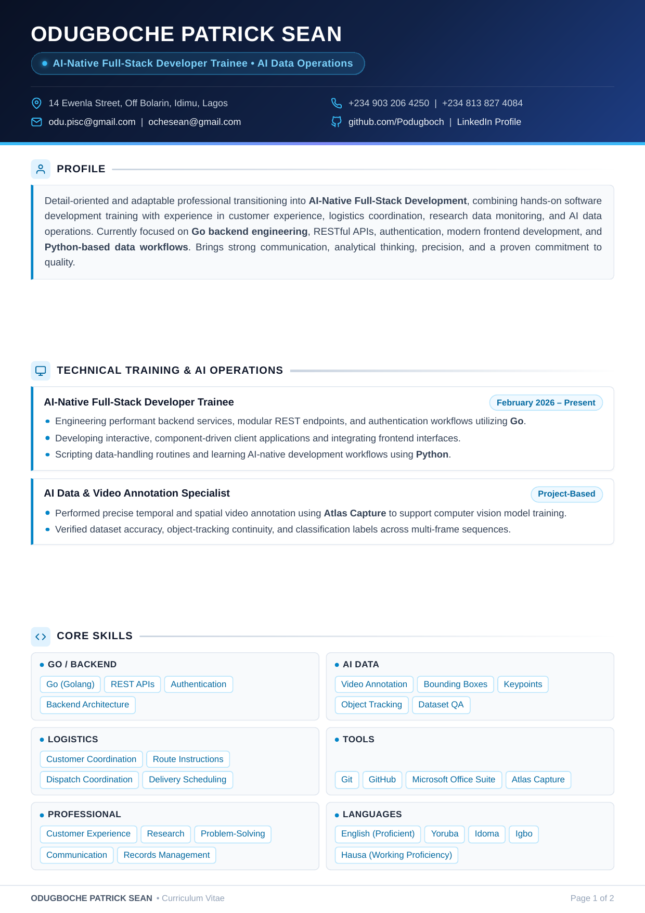
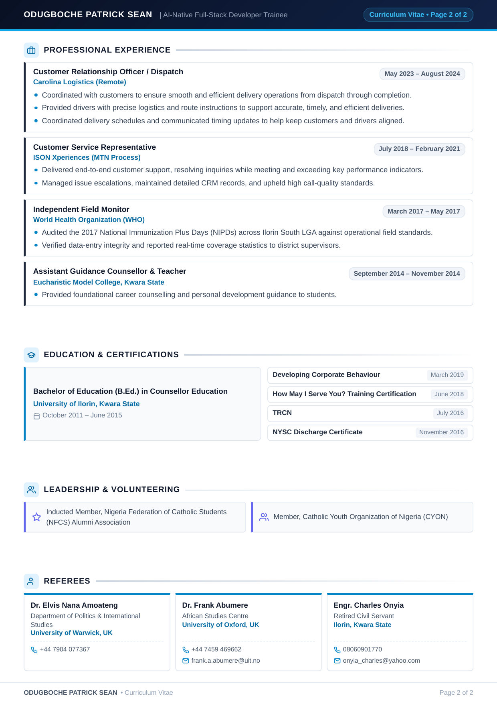

# Curriculum Vitae — Odugboche Patrick Sean

Professional Curriculum Vitae repository for **Odugboche Patrick Sean** — AI-Native Full-Stack Developer Trainee & AI Data Operations Specialist.

---

## 📄 Preview

<p align="center">
  
  
</p>

---

## 📁 Repository Structure

- [`ODUGBOCHE_PATRICK_SEAN_CV.pdf`](ODUGBOCHE_PATRICK_SEAN_CV.pdf) — Production-ready vector PDF document.
- [`resume.html`](resume.html) — Source HTML5 & CSS3 template with print styles and vector icons.
- `preview-page-1.png` — Rendered preview of Page 1.
- `preview-page-2.png` — Rendered preview of Page 2.

---

## 🛠️ How to Compile / Re-generate the PDF

You can rebuild the PDF directly using headless Google Chrome or Chromium:

```bash
google-chrome --headless=new --disable-gpu --no-sandbox --no-pdf-header-footer --print-to-pdf="ODUGBOCHE_PATRICK_SEAN_CV.pdf" resume.html
```

To export high-resolution PNG page previews:

```bash
pdftoppm -png -r 150 ODUGBOCHE_PATRICK_SEAN_CV.pdf preview-page
```

---

## 📬 Contact & Links

- **Email**: [odu.pisc@gmail.com](mailto:odu.pisc@gmail.com) | [ochesean@gmail.com](mailto:ochesean@gmail.com)
- **Phone**: +234 903 206 4250 | +234 813 827 4084
- **GitHub**: [@Podugboch](https://github.com/Podugboch)
- **LinkedIn**: [patrick-odugboche](https://linkedin.com/in/patrick-odugboche-826115176)
